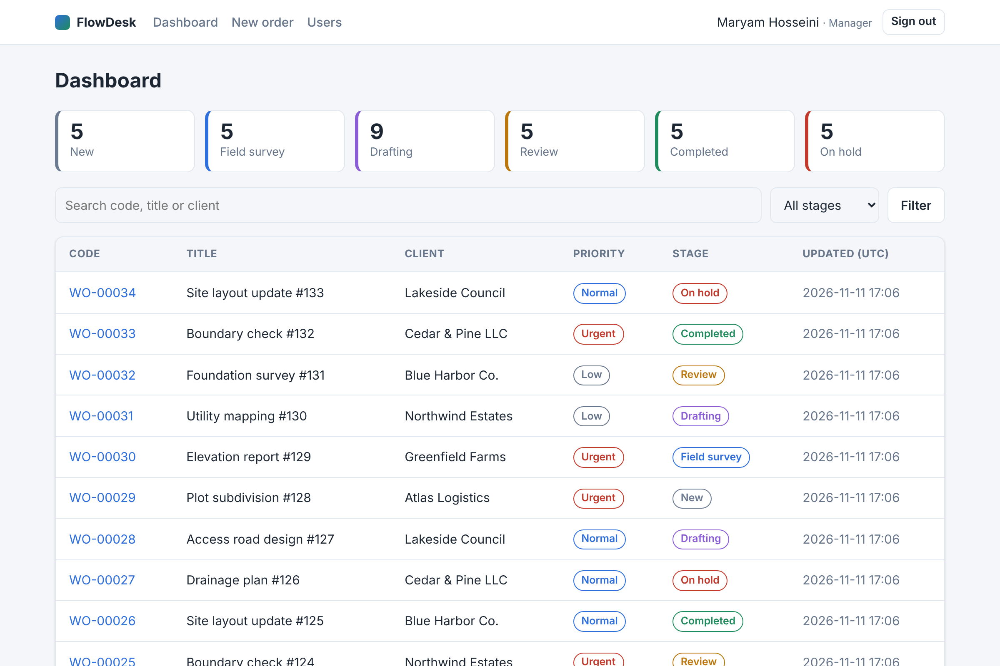
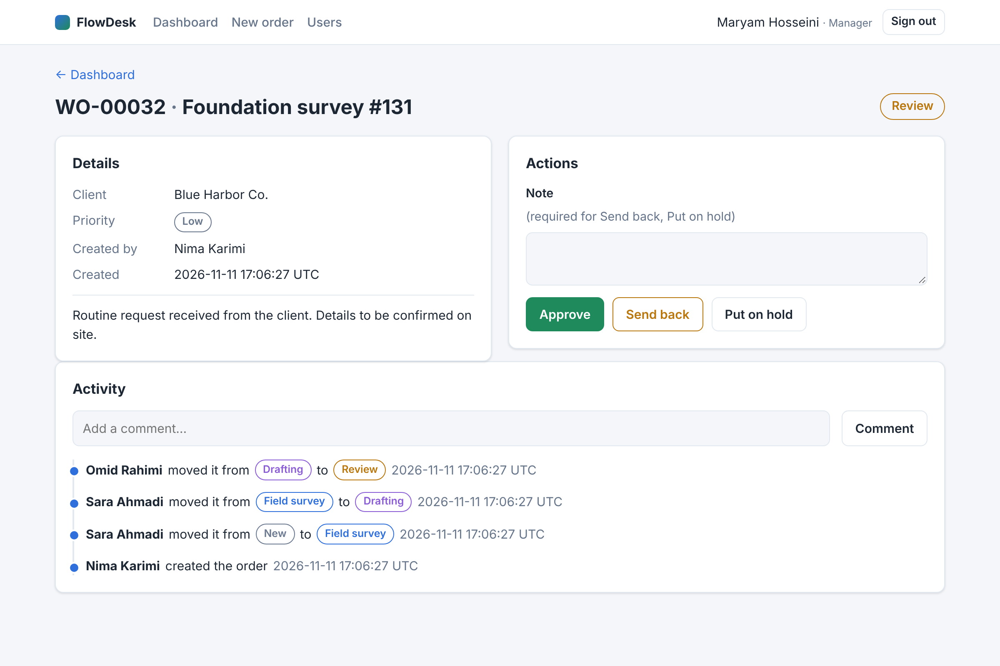
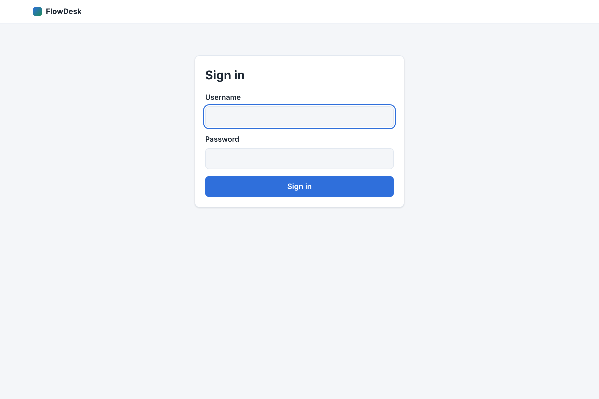
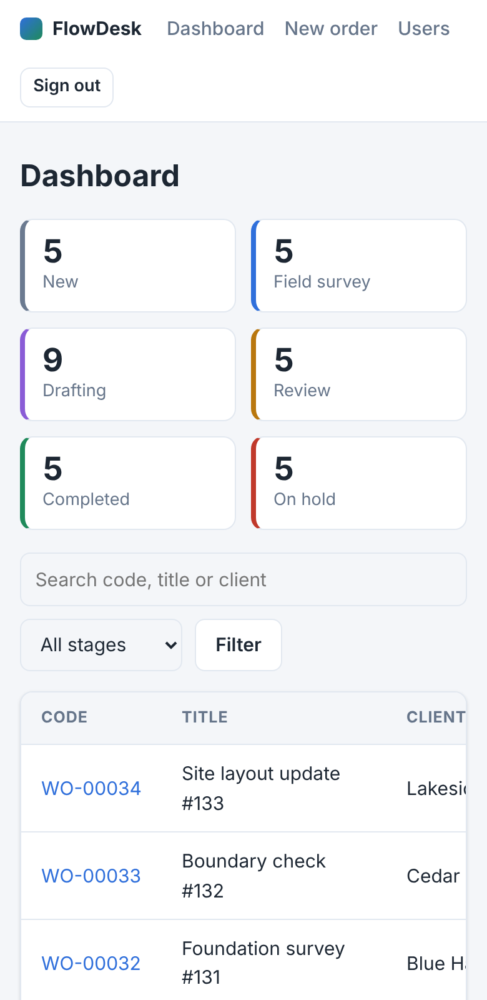

# FlowDesk

[](https://github.com/mahsa2nyayi/flowdesk/actions)

A role-based **work-order workflow system** in plain modern PHP 8: PDO, a small hand-written router and a
strict state machine, with no framework. Work orders move through a pipeline
(New → Field survey → Drafting → Review → Completed, plus On hold), and each step can only be taken by the
roles allowed to take it. Every change is written to an audit trail.



| Order detail with actions and audit timeline | Sign in |
|---|---|
|  |  |

Responsive, with automatic dark mode (`prefers-color-scheme`):



## Features

- **Four roles** (manager, intake, surveyor, drafter) with server-side authorisation on every route.
- **Workflow engine** (`src/Workflow.php`): a pure, I/O-free state machine. It defines allowed transitions per role,
  mandatory notes for *Send back* and *Put on hold*, and *Resume* returning to the stage the order was held from.
- **Audit trail**: every creation, transition and comment is stored with user, time and stages.
- **Dashboard**: per-stage counters, search (code, title, client), stage filter and pagination.
- **User management** for managers: create users, enable/disable accounts.

## Security design

| Concern | What the code does |
|---|---|
| SQL injection | PDO with real prepared statements (`ATTR_EMULATE_PREPARES = false`) everywhere; `LIKE` wildcards escaped in search |
| Passwords | `password_hash()` / `password_verify()`, automatic rehash, 10–72 character policy |
| Brute force | Per user + IP lockout after 5 failures in 15 minutes; hash check runs even for unknown users to equalise timing |
| Session fixation | Session id regenerated on login; strict mode; `HttpOnly`, `SameSite=Lax`, `Secure` on HTTPS |
| CSRF | Per-session token verified on **every** POST, including login and logout |
| XSS | All output escaped through one helper `e()`; strict Content-Security-Policy (no inline scripts or styles) |
| Access control | Role checks in the dispatcher; redirects *return* a response, so nothing after an auth failure can execute |
| Stale accounts | The user is re-read from the database on every request, so disabling an account takes effect immediately |
| Races | Stage changes use `UPDATE … WHERE stage = <stage that was read>` inside a transaction |
| Errors | Exceptions are logged server-side; the browser only sees a generic message unless `APP_DEBUG=1` |
| Headers | CSP, `X-Frame-Options`, `X-Content-Type-Options`, `Referrer-Policy`, `Cache-Control: no-store`, HSTS on HTTPS |

## Run it

Requires PHP 8.1+ with `pdo_sqlite` and `mbstring`. There is nothing to install.

```bash
php bin/seed.php                    # creates var/flowdesk.sqlite with demo users and 34 sample orders
php -S 127.0.0.1:8000 -t public     # open http://127.0.0.1:8000
```

Demo accounts (local use only): `manager`, `intake`, `surveyor`, `drafter`, all with password `demo-password-123`.
Seeding refuses to run when `APP_ENV=production`.

## Tests

```bash
php tests/run.php
```

The suite (24 tests) runs the full application in-process with an in-memory database, so it needs no web server or
extra packages. It covers the state machine, repository behaviour and rollback, hashing, lockout, session
regeneration, CSRF, role-based access, XSS escaping, validation, odd query parameters, and a complete order
lifecycle through all four roles.

## Project layout

```
public/index.php      front controller (sessions, DB, app)
src/App.php           wiring, CSRF, auth and role checks, security headers
src/Workflow.php      pure state machine
src/WorkOrders.php    repository, transactions, audit events
src/Auth.php          login, lockout, session handling
src/Http/             Request, Response, Router, Controllers
templates/            PHP templates (escaped output only)
database/schema.sql   schema
tests/run.php         dependency-free test runner
```

## Notes and limits

- Tested with SQLite. `Database::connect()` accepts any PDO DSN, but the bundled schema uses SQLite syntax
  (`AUTOINCREMENT`) and would need small changes for MySQL or PostgreSQL.
- No password-reset flow, e-mail, file uploads or API. They are out of scope for this sample.
- Times are stored and displayed in UTC.

## License

MIT
